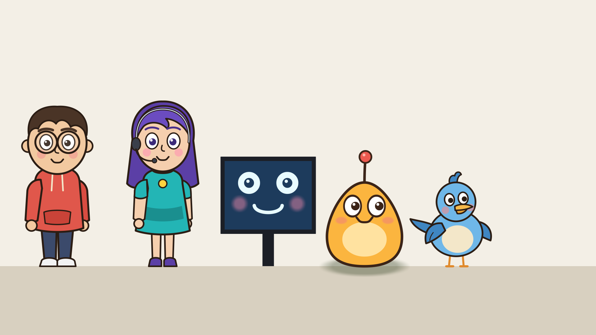

<!-- Building block of the animation-studio plugin - a reference document, NOT a skill (it is not loaded
     into every session). User skills point here. `<plugin>` = the plugin folder, the path that
     the variable CLAUDE_PLUGIN_ROOT stands for in the SKILL.md files. -->
# characters – the cast and the rig convention

*The cast of the cartoon skills and how to rig them – Tim, Lia (SVG figures with lip-sync mouths), the Computer (a face on a screen), Pip (code-drawn pear-shaped hero with spring antenna) and Fips (SVG bird) – with figure sheets, the SVG rig convention (group ids, pivot circles, feet point), Python builders (pip_figure.py, computer.py, figures.py) and the steps to add a new figure drawn in Inkscape. Used by animated-short, animated-music-video, talking-character and the other cartoon skills.*

**Run a script of this block:** `uv run "<plugin>/skills/characters/scripts/<script>.py" ...` - the script names in the tables below live in `<plugin>/skills/characters/scripts/`; each script declares its own packages (PEP 723), so no `--with`. A script whose first line says it runs in another interpreter (Blender, gpu_python, tts_python) is started by the scripts that need it.

 – `assets/figure_sheet.png`: Tim, Lia, Computer, Pip, Fips in rest pose on one floor
line at their scene scale. Regenerate (or check a new figure) with
`uv run "<plugin>/skills/characters/scripts/figure_sheet.py" --out <dir> [--add my.svg] [--pivots]`.

Scripts (`<plugin>/skills/characters/scripts/`) are importable in any scene made with
`toon-2d/scripts/new_scene.py` (`import _toon` puts them on the path), or with `_studio.use("toon-2d", "characters")`.

| Script | What |
|---|---|
| `pip_figure.py` | `pip(end, x_keys, y_keys, sq_keys, lean_keys, hops, ground, size, eye_keys, look_keys, mouth_open, mouth_cues, antenna_kicks, flip)` → `[shadow, Pip]`; `blink(frames)` |
| `computer.py` | `computer(rect, blink, bounce, mouth_cues, face_on, look_keys)` → screen frame + screen + face layers |
| `figures.py` | `FIGURES` (bundled SVGs + feet + scale), `load(name or svg, work_dir)` → (root, pivots), `around(PIV, part, kids, angle=/scale=)`, `blink_keys(frames)` |
| `figure_sheet.py` | the sheet above, `--pivots` marks every pivot red |

Animated-music-video's `scene.py` drives Tim/Lia/Computer from a song (dance styles, gestures, listening); the
builders here are for hand-keyed scenes and shorts.

## Figure sheets

### Tim (`assets/figures/tim.svg`)
Young developer: brown hair, round glasses, red hoodie with pocket, blue jeans, white sneakers. 400×600 px SVG,
feet at **(200, 590)**, scene scale 1/72 (≈ 8.2 units tall; in song scenes the set scales him further). Parts with
pivots: `arm_l`, `arm_r`, `kopf`, `auge_l`, `auge_r`, `brauen`, `koerper`, `mund` (mouth point); also `beine`,
`brille` (glasses), `pupille_l/r`. No mouth in the SVG – lip sync draws it at `pivot_mund` (size 0.58). Personality:
eager, a bit clumsy, talks with his hands.

### Lia (`assets/figures/lia.svg`)
The singer (an AI persona): long purple hair, headset with microphone on her right cheek, teal dress, purple shoes.
Same scale and feet as Tim. Parts: `arm_l`, `arm_r`, `kopf`, `auge_l/r`, `pupille_l/r`, `brauen`, `koerper`,
`beine`, `haare_hinten` (hair behind the body), `headset`, `mund`. Personality: confident, warm, performs to the
audience.

### Computer (`scripts/computer.py`)
No body: a face on a screen – two big round light eyes with dark pupils and a glint, pink cheeks, a light smile or
lip-sync mouth, dark-blue screen `#1d3b5c` in a frame `#1c1f26`. Everything scales with the screen rectangle (sets
`room`/`stage` define one under `"screen"`). Acting: blink, a squash bounce on beats, look keys move the pupils;
`face_on` hides the face while the screen shows text (big words, a terminal line).

### Pip (`scripts/pip_figure.py`, drawn in code)
The hero of the exercises: orange pear-shaped body (`#fbb53f`, ink `#3b2418`), cream belly, pink cheeks, two big
white eyes (centres ±0.42, 2.12 local), smile or "O" mouth, an antenna with a red ball that follows through on a
spring. Local body 2.95 high; `size=0.62` ≈ 1.8 units tall. Rig: `Pip` (offset, lean, size) > `Squash` (about the
feet) > antenna (root (0, 2.9), baked spring) / body / belly / cheeks / `Eye` ×2 (blink scale) > `Pupil` (look) /
mouth. Faces right; `flip=True` mirrors. Full scene with Pip: `toon-2d/assets/example_scene.py`.
Personality: curious, easily startled, joyful – reacts with whole-body squash.

### Fips (`assets/figures/fips.svg`)
A small round blue bird (`#6fb7e8`, darker wings `#3f86c2`), cream belly, orange beak in two halves, crest, orange
legs. 400×400 px, feet at **(200, 380)**, scale 1/80 (≈ 4.1 units tall; scale the group, e.g. 0.3, to make him
small next to Pip). Parts with pivots: `kopf`, `auge_l/r` (+ `pupille_l/r`), `schnabel_unten` (lower beak opens –
there is no mouth), `fluegel_vorn`, `fluegel_hinten` (flap ±55–75°), `koerper`; also `schnabel_oben`, `schwanz`,
`beine`. Faces right; mirror with a negative x scale on his outer group. Full scene: `toon-2d` template
`figure_scene.py`. Personality: cheeky, quick, nervous – everything in fast flutters and sharp head turns.

## SVG rig convention (any new figure)

Draw in Inkscape (any shapes – circles, ellipses, paths, transformed groups; `normalize()` turns them into paths):
1. Every movable part is a **group with a meaningful id** (Object Properties › ID). Nesting allowed (eyes inside the
   head). Drawing order = stacking order.
2. Pivot of a part: a small circle with id **`pivot_<part>`** inside the group – removed from the drawing and
   returned as coordinates.
3. Keep the ids of the bundled figures so scene builders find the parts: `arm_l`, `arm_r`, `kopf` (head),
   `auge_l`/`auge_r` (eyes), `pupille_l`/`pupille_r` (pupils, a group inside the eye), `brauen` (brows), `koerper`
   (body), `beine` (legs); `pivot_mund` marks the mouth (leave the mouth out if it will lip-sync).
4. Human-sized figures: 400×600 px canvas, feet at **(200, 590)**, ~560 px tall – then they match Tim and Lia at
   scale 1/72. Animals/props: any canvas; note the feet point and the scale in `figures.FIGURES` or pass them to
   `load(svg, feet=(x, y), scale=1/80)`.
5. Arms hang behind the body (right for dancing); actions that must read in front of the body (typing, holding)
   need extra arm drawings in front (switched with `amount`).

## Adding a new figure – steps

1. Draw the SVG following the convention (or ask the user for theirs); put it in the project folder, not the plugin.
2. Check it: `figure_sheet.py --out sheet --add my_figure.svg --pivots` – look at the PNG: same floor line, sensible
   size next to Tim/Lia/Pip, a red dot on every pivot at the joint, nothing missing (`load` prints the parts).
3. Fidelity check once: `uv run <toon-2d>/scripts/svg2sif.py my_figure.svg` writes `my_figure_static.sif`; render it
   (`render.py --single 0`) next to an Inkscape PNG export (`inkscape my_figure.svg --export-type=png`).
4. Rig it in a scene: `root, PIV = load("my_figure.svg", work_dir=HERE / "cache")`,
   `emit(root, {"kopf": lambda kids, p: around(PIV, "kopf", kids, angle=anim("angle", HEAD)), ...})` – wrapped parts
   become animated groups, the rest plain named groups; drawing order is kept. Run scenes with
   `uv run make_scene.py` (the figure template declares svgelements; add it to your own scene's PEP 723 header).
5. For songs: add it to `project.json` "figures" of the music-video skill (`"svg": "...", "size", "mouth"`).

## The rig in other techniques

Every figure that follows the rig convention works with these toon-2d tools without extra work:
- `toon-2d/scripts/breakout.py` – the figure climbs out of a comic panel as a paper stand-up and dances in front of
  the page (arms, head, eyes, pupils, brows, lip-sync mouth at `pivot_mund`; Fips: wings as arms, beak opens).
- `toon-2d/scripts/figure_3d.py` – the figure becomes a rounded 3D toon figure in Blender (morph, turn, pop); colours
  come from the fills, outlines from the strokes, the mouth is drawn at `pivot_mund` ("o" or "smile").
Helps both: closed, filled shapes per part (not only strokes), the drawing order front-to-back as it should stack.

Another agent adds `references/claudia.md` (the photoreal singer Claudia) – see there for her canon.
